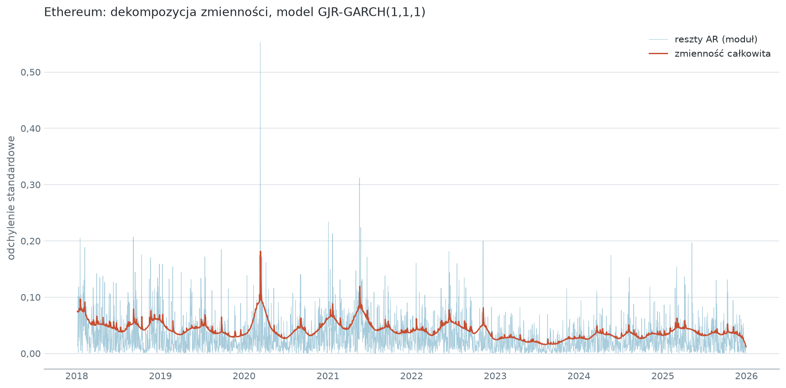
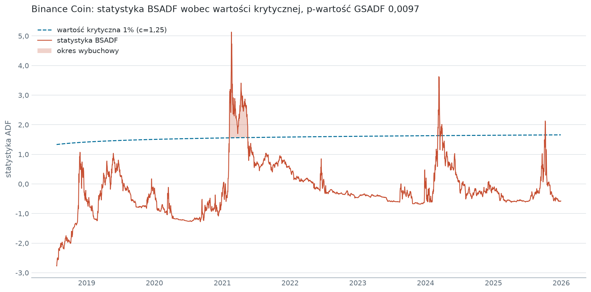
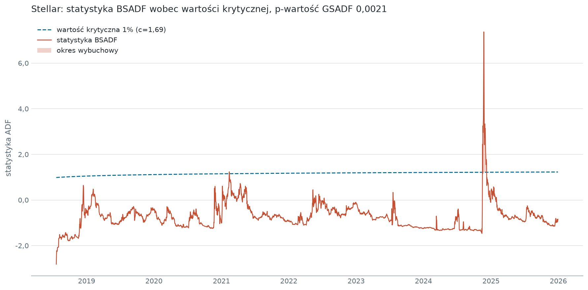

# Identyfikacja baniek spekulacyjnych na rynku kryptowalut

Test PSY (GSADF/BSADF) z korektą wild bootstrap na dziennych cenach 12 kryptowalut z lat 2018-2025. Istotne epizody wybuchowego zachowania cen stwierdzono dla 3 z 12 aktywów na poziomie istotności 1%: Binance Coin, Bitcoina i Stellara. Główne ograniczenie: etap testu wymaga karty NVIDIA, bo sekwencja BSADF liczona jest w jądrach CUDA.


## Badanie

Badanie replikuje i rozszerza Hafnera (2020) na trzy sposoby: stosuje test PSY (Phillips, Shi i Yu, 2015) zamiast PWY (Phillips, Wu i Yu, 2011), bo ten drugi traci moc przy wielu następujących po sobie epizodach. Dokłada Binance Coin i Dogecoin do 10 szeregów obecnych u Hafnera, przedłuża próbę do końca 2025 roku.

## Dane

Dzienne ceny zamknięcia 12 kryptowalut z Yahoo Finance, od 2018-01-01 do 2025-12-30. Dolną granicę wyznacza dostępność notowań: Yahoo Finance podaje 10 z 12 szeregów dopiero od 2017-11-09, więc 2018 to pierwszy pełny rok z kompletem danych. Każdy szereg ma 2921 obserwacji surowych i od 2917 do 2920 po usunięciu braków powstałych przy różnicowaniu i dopasowaniu modelu AR.

W repozytorium leżą wszystkie trzy warstwy danych, nie tylko surowa. Warstwy pochodne pozwalają obejrzeć wyniki i uruchomić testy bez karty NVIDIA, której wymaga ostatni etap. Pobranie danych od nowa wykonuje `src/data_load.py`. Warunki korzystania z Yahoo Finance ograniczają redystrybucję do użytku osobistego.

## Metoda

Metoda ma cztery etapy. Pierwsze dwa realizuje `src/pre_processing.py`, trzeci `src/model.py`, czwarty `src/validation.py`, każdemu modułowi odpowiada jedna komórka w [notebooks/01_banki_spekulacyjne.ipynb](notebooks/01_banki_spekulacyjne.ipynb).

**Warunkowa wartość oczekiwana.** Logarytmiczne stopy zwrotu modelowano procesem AR(p), którego rząd wybiera kryterium BIC. Dla 7 z 12 szeregów BIC wskazał p=0, czyli brak autokorelacji liniowej wykrywalnej tym kryterium.

**Trend zmienności.** Reszty rozłożono zgodnie z Hafnerem (2020) na składnik deterministyczny `g(t/T)` i stochastyczny `h_t`. Składnik `g(t/T)` oszacowano lokalną jądrową regresją liniową na kwadratach reszt, z jądrem gaussowskim i szerokością pasma z walidacji krzyżowej najmniejszych kwadratów. Obserwowalne są kwadraty reszt, więc regresja estymuje lokalną wariancję, a `g(t/T)` jest jej pierwiastkiem.

**Zmienność krótkookresowa.** Dla każdego szeregu oszacowano GARCH(1,1) i GJR-GARCH(1,1,1), zachowując specyfikację asymetryczną tylko przy istotnym parametrze dźwigni i niższym BIC. Warunek spełnia wyłącznie Ethereum, z `gamma` 0,0793 przy p-wartości 0,0185.



Zmienność całkowita to iloczyn trendu i odchylenia standardowego ze składnika krótkookresowego. Dekompozycja rozdziela te dwa źródła, nie rozstrzyga natomiast, czy spadek trendu wynika z dojrzewania rynku, czy z układu konkretnych zdarzeń w próbie.

**Test PSY.** Statystyka GSADF (Generalized Sup ADF) to supremum statystyk ADF po wszystkich oknach o zmiennym początku i końcu. Sekwencja BSADF (Backward Sup ADF) podaje to supremum dla każdego punktu końcowego i służy do datowania. Rozkład zerowy generuje wild bootstrap na 10 000 ścieżek z dwupunktowym rozkładem Mammena, odtwarzających strukturę zmienności szeregu. Ścieżki zawierają dryf równy medianie historycznych przyrostów logarytmicznych cen, co oddziela trend wzrostowy od eksplozji cenowej. Minimalne okno regresji to 200 obserwacji, krzywa wartości krytycznych ma postać `CV(t) = log(log(t)) / c`, a parametr `c` kalibrowany jest tak, aby na końcu próby odpowiadał górnemu kwantylowi 1%.

Regresje ADF dla wszystkich okien liczone są na GPU. Sumy iloczynów krzyżowych akumulowane są raz jako sumy prefiksowe, więc suma dla dowolnego okna to różnica dwóch wpisów. Układ równań normalnych rozwiązywany jest wzorami Cramera, co utrzymuje całą regresję w rejestrach.

### Dlaczego test napisano od zera

W styczniu 2026, gdy powstawało badanie, Python nie miał implementacji testów rekurencyjnych prawostronnych. `statsmodels` i `arch` dają wyłącznie testy liczone raz na całej próbie: ADF, DFGLS, KPSS, Phillips-Perron, Zivot-Andrews. Gotowe pakiety istniały tylko w R - `exuber` i `MultipleBubbles`. Pythonowy odpowiednik `exuber`, pakiet [pyexuber](https://pypi.org/project/pyexuber/), ukazał się 2026-10-05, czyli po zakończeniu badania.

Własna implementacja zostaje także teraz, bo metoda różni się od domyślnej procedury `exuber` w dwóch miejscach rozstrzygających o wynikach. Krzywa wartości krytycznych ma postać analityczną kalibrowaną w końcu próby, a nie sekwencję symulowaną dla każdego punktu osobno. Ścieżki zerowe budowane są z reszt modelu AR, nie z pierwszych różnic. Wywołanie biblioteki policzyłoby inną specyfikację.

Sama statystyka jest natomiast zweryfikowana niezależnie. Wywołanie `exuber.radf(log_price, minw=201, lag=1)` zgadza się z jądrem CUDA w każdym punkcie sekwencji BSADF dla wszystkich 12 szeregów, z maksymalną różnicą 8,9e-11. Wartość 201 zamiast 200 wynika z konwencji liczenia okna opisanej w [Ograniczeniach](#ograniczenia). Porównanie wykonano w osobnym środowisku. `pyexuber` nie jest zależnością projektu.

## Wyniki

Bańki stwierdzono dla 3 z 12 kryptowalut na poziomie 1%.

| Kryptowaluta | GSADF  | p-wartość | Bańka na 1% |
| ------------ | ------ | --------- | ----------- |
| Stellar      | 7,3693 | 0,0021    | tak         |
| Bitcoin      | 4,0317 | 0,0072    | tak         |
| Binance Coin | 5,1305 | 0,0097    | tak         |
| XRP          | 4,6901 | 0,0198    | nie         |
| Cardano      | 2,9617 | 0,0870    | nie         |
| Ethereum     | 2,4822 | 0,1687    | nie         |
| Dash         | 3,0216 | 0,2096    | nie         |
| NEM          | 2,9224 | 0,2122    | nie         |
| Dogecoin     | 3,3268 | 0,2164    | nie         |
| Bitcoin Cash | 2,5449 | 0,2493    | nie         |
| Litecoin     | 1,5914 | 0,6271    | nie         |
| Monero       | 1,3854 | 0,9306    | nie         |

XRP nie przekracza progu 1%, ale pozostaje poniżej 5%. Wynik ten jest słabszy statystycznie i nie rozstrzyga, czy zachowanie cen na przełomie 2024 i 2025 roku było epizodem wybuchowym.

Najdłuższy epizod to 99 dni dla Binance Coin, od 2021-02-08 do 2021-05-18.



Epizody grupują się w dwóch falach. Pierwsza przypada na przełom 2020 i 2021 roku i obejmuje Bitcoina od 2020-12-17, a następnie altcoiny, w tym Binance Coin od 2021-02-08. Druga przypada na przełom 2024 i 2025 roku i ogranicza się do Stellara oraz, przy poziomie 5%, do XRP.



Łącznie sekwencja BSADF przekracza krzywą w 87 epizodach, z czego 29 osiąga zalecaną minimalną długość `ln(T)`, która dla tej próby wynosi 7 dni. Pełne zestawienie jest w [reports/bubble_episodes.csv](reports/bubble_episodes.csv), statystyki testu w [reports/gsadf_results.csv](reports/gsadf_results.csv), a parametry modeli zmienności w [reports/garch_parameters.csv](reports/garch_parameters.csv).

Wyniki wskazują, że bańki na rynku kryptowalut nie są zjawiskiem powszechnym. Nie rozstrzygają natomiast, co je wywołuje ani czy brak epizodu oznacza wycenę zgodną z wartością fundamentalną.

## Ograniczenia

- Szerokość pasma dobrana walidacją krzyżową wyszła ujemna dla Bitcoina, Bitcoin Cash i Stellara. Jądro gaussowskie zależy od kwadratu szerokości, więc oszacowanie pozostaje poprawne liczbowo, ale wartości tych nie należy czytać jako dobranej gładkości.
- Tabela epizodów zawiera wszystkie przekroczenia krzywej, także jednodniowe. Kolumna `meets_min_duration` wskazuje te, które osiągają `ln(T)`; filtrowanie zostawiono czytelnikowi, żeby próg dało się zmienić bez przeliczania testu.
- Rozkład zerowy zakłada błądzenie losowe z dryfem. Odrzucenie hipotezy wskazuje na zachowanie wybuchowe, nie rozstrzyga natomiast o jego przyczynie.
- Minimalny czas trwania epizodu liczy `int(np.log(T))`, co dla tej próby ucina 7,98 do 7 dni zamiast zaokrąglić do 8. Trzy epizody o długości dokładnie 7 dni są przez to oznaczone kolumną `meets_min_duration` jako spełniające próg.

### Odstępstwo od procedury Hafnera w budowie ścieżek zerowych

Krok 3 algorytmu Hafnera generuje ścieżkę zerową jako `y*_t = â + y*_{t-1} + Σ α̂_j Δy*_{t-j} + ε*_t`, gdzie `â` i `α̂` pochodzą z modelu AR dopasowanego do stóp zwrotu. Człon z sumą odtwarza w próbach bootstrapowych autokorelację stóp zwrotu, co Hafner podaje jako jawny cel tej modyfikacji.

Ten kod zastępuje `â` medianą przyrostów logarytmicznych cen i pomija człon autoregresyjny. Obie wielkości potrafią różnić się znakiem: dla Litecoina mediana wynosi 0,0004 przy stałej AR równej -0,0004, dla Dash 0,0003 wobec -0,0011. Dla Monero mediana jest 72 razy większa od stałej.

Koszt tego odstępstwa zmierzono, przeliczając cały test z krokiem 3 Hafnera na 10 000 ścieżek. P-wartości przesuwają się o nie więcej niż 0,20, mediana różnicy wynosi 0,0041, a jedna konkluzja się zmienia: Binance Coin przechodzi z 0,0097 na 0,0135, czyli powyżej progu 1%, i bańki byłyby dwie zamiast trzech.

Liczby z tego akapitu pochodzą z jednorazowego porównania wykonanego poza potokiem. Potok w tym repozytorium liczy wariant opisany w sekcji Metoda, nie wariant Hafnera.

## Struktura projektu

```
.
├── data/
│   ├── raw/            ceny zamknięcia z Yahoo Finance, 12 plików
│   ├── interim/        reszty AR, trend g(t/T), reszty standaryzowane
│   └── processed/      zmienność całkowita i wybrany model GARCH
├── notebooks/
│   └── 01_banki_spekulacyjne.ipynb    narracja badania, bez logiki obliczeniowej
├── src/
│   ├── paths.py              katalogi projektu
│   ├── data_load.py          pobranie z Yahoo Finance i wczytywanie plików
│   ├── pre_processing.py     AR(p) wg BIC i jądrowa estymacja g(t/T)
│   ├── model.py              GARCH(1,1) i GJR-GARCH(1,1,1) z wyborem specyfikacji
│   ├── psy_kernels.py        sumy prefiksowe i jądro CUDA sekwencji BSADF
│   ├── validation.py         wild bootstrap, p-wartość, kalibracja i datowanie
│   ├── plot_style.py         jedyne źródło barw i proporcji rysunków
│   └── visualisation.py      wykresy zapisywane do reports/figures/
├── reports/
│   ├── gsadf_results.csv     statystyki testu i p-wartości
│   ├── bubble_episodes.csv   datowane epizody wybuchowe
│   ├── garch_parameters.csv  parametry modeli zmienności
│   └── figures/              12 przebiegów BSADF i 12 dekompozycji zmienności
├── tests/                    gwarancje metodologiczne i spójność warstw danych
├── requirements.txt
└── requirements-dev.txt
```

## Uruchomienie

```bash
python -m venv venv
```

```bash
venv\Scripts\activate
```

```bash
pip install -r requirements.txt
```

Następnie uruchom [notebooks/01_banki_spekulacyjne.ipynb](notebooks/01_banki_spekulacyjne.ipynb) od góry do dołu. Notebook sam odnajduje korzeń projektu, więc katalog roboczy nie ma znaczenia.

Pomiar na GeForce RTX 4060 Ti i Pythonie 3.12.10: przygotowanie danych i modele zmienności zajmują 1 minutę 46 sekund, test PSY 10 minut 44 sekundy, całość 12,5 minuty. Pobranie danych uruchamia się tylko przy pustym `data/raw/`, więc powtórny przebieg nie sięga do sieci.

Bootstrap jest zaziarnowany wartością `SEED` w `src/validation.py`, więc p-wartości z tabeli wyżej odtwarzają się co do cyfry. Po zmianie ziarna należy oczekiwać odchyleń rzędu błędu Monte Carlo, czyli do 0,005 przy 10 000 ścieżek.

## Testy

```bash
pytest
```

175 testów w dwóch plikach. [tests/test_methodology.py](tests/test_methodology.py) sprawdza gwarancje, na których stoją wnioski: momenty rozkładu Mammena, skalę ścieżek bootstrapu, obecność dryfu, kwantyl kalibracji, monotoniczność krzywej wartości krytycznych, granice epizodów oraz zgodność sum prefiksowych z iloczynami liczonymi wprost. Dwa testy wymagają karty NVIDIA i pomijają się same bez niej: jeden porównuje statystykę z jądra CUDA z niezależną regresją najmniejszych kwadratów, drugi sprawdza, że pozycje przed minimalnym oknem nie zwracają niezainicjowanej pamięci. [tests/test_data_integrity.py](tests/test_data_integrity.py) sprawdza spójność trzech warstw danych, odwracalność standaryzacji i dodatniość trendu zmienności.

Zestaw zweryfikowano mutacyjnie: 7 celowo zepsutych gwarancji, 7 wykrytych przez właściwe testy.

